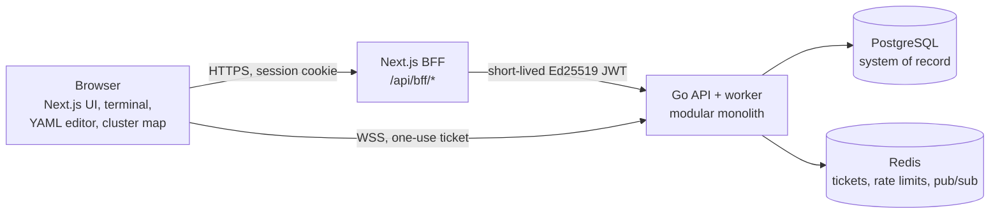

# KubeDojo

**Master Kubernetes, one command at a time.**

KubeDojo is an open-source, browser-based platform for learning Kubernetes by doing. Each lesson pairs a short explanation with a lab: a simulated cluster you drive with real `kubectl` commands, a YAML editor, a live map of what your commands changed, and automatic grading that tells you when you've got it right.

> **Status: early development, not yet launched.** Parts 01–16 of the [20-part V1 plan](docs/master-plan.md) are merged: the simulator, kubectl, YAML editor, live terminal, cluster map and grading all work. Still to come: the remaining polish, operations and launch work. There is no public instance yet.

## Contents

- [What you get](#what-you-get)
- [Curriculum](#curriculum)
- [How the simulator works](#how-the-simulator-works)
- [Architecture](#architecture)
- [Tech stack](#tech-stack)
- [Quick start](#quick-start)
- [Repository layout](#repository-layout)
- [Documentation](#documentation)
- [Contributing](#contributing) · [License](#license)

## What you get

| Feature | What it does |
| --- | --- |
| **Interactive lessons** | 30 lessons in 6 courses, written in Markdown and versioned in Git under [`content/`](content) |
| **Simulated cluster** | Every lab gets its own persistent cluster with Pods, Deployments, ReplicaSets, Services, Endpoints, ConfigMaps, Secrets, Namespaces and Nodes. It is reconciled by built-in controllers (scheduler, kubelet, ReplicaSet/Deployment, endpoints) |
| **Real `kubectl`** | An in-browser terminal accepting the documented subset of `kubectl`: `get`, `describe`, `logs`, `run`, `create`, `apply -f`, `delete`, `expose`, `scale`, `set image`, `rollout`, `label`, and more |
| **YAML editor** | Write manifests in a CodeMirror 6 editor with diagnostics, then `kubectl apply -f` them |
| **Cluster map** | A React Flow graph of how objects relate (Deployment → ReplicaSet → Pod ← Service), updated live, plus a screen-reader-friendly list view |
| **Live updates** | Commands and state changes stream over a WebSocket, so every open tab of a lab stays current |
| **Grading and XP** | Deterministic checks on the cluster state and your answers, ordered hints, XP, streaks and achievements |
| **Accounts and progress** | Sign in with Google, GitHub or email (via Asgardeo), onboarding, a dashboard, a profile page and an optional leaderboard |

## Curriculum

| Course | Lessons |
| --- | --- |
| Kubernetes fundamentals | Cluster architecture · Listing resources · Namespace navigation · Labels and selectors · Declarative vs imperative |
| Pods and workloads | Launch a Pod · Inspect a Pod · Create a Deployment · Scaling Deployments · Rollout and rollback · Troubleshoot a Pending Pod |
| Networking | Service basics · Expose a Deployment · Selectors and endpoints · ClusterIP vs NodePort · Debug missing endpoints |
| Configuration | ConfigMaps · Environment from ConfigMaps · Secrets awareness · Editing manifests |
| Cluster operations | Inspect nodes · Namespaces and scope · Labels and annotations · Requests, limits and scheduling · Events and diagnostics |
| Troubleshooting | CrashLoopBackOff · Image pull failure · Replica mismatch · Wrong labels · Capstone recovery |

Lesson slugs, goals and grading for each are in [course-outline.md](docs/product/course-outline.md). To write your own, see [authoring.md](docs/content/authoring.md).

## How the simulator works

The cluster is **simulated**: no containers run, nothing touches a real cluster, and no command you type is run in a shell on the server.

- **Allowlisted grammar.** The terminal parses only `kubectl` (or `k`). Shell syntax such as `;`, `&&`, `|`, `>`, `$(...)` and backticks is rejected before parsing.
- **Kubernetes v1.37 subset.** The simulator implements a documented subset of Kubernetes v1.37. Anything outside it returns an `UNSUPPORTED` error instead of pretending to work. The [compatibility matrix](docs/architecture/simulator-compatibility.md) lists every supported command, flag, resource and behavior.
- **Deterministic.** Each change advances a simulated clock by one tick and reconciles before the command returns. The same commands on the same lab always give the same output, byte for byte ([ADR-0006](docs/adr/0006-deterministic-reconciliation.md)).
- **Server-authoritative.** Lab state lives in PostgreSQL. The browser only displays it, so clients can't fake progress or XP.
- **Clearly labeled.** Events and logs are synthetic and marked as simulated in the UI.

## Architecture



- The **browser** never talks to the Go REST API directly. The Next.js backend-for-frontend checks the session and signs a ≤60-second assertion for each request ([ADR-0003](docs/adr/0003-auth-bff.md)).
- The **Go API** is a modular monolith ([ADR-0001](docs/adr/0001-modular-monolith.md)) with modules for auth, courses, progress, labs, the simulator, kubectl, grading, gamification, realtime and admin.
- **PostgreSQL** holds everything that matters. **Redis** holds only short-lived coordination data and can be flushed safely ([ADR-0004](docs/adr/0004-pg-state-redis-events.md)).

More in [architecture/overview.md](docs/architecture/overview.md).

## Tech stack

| Layer | Technology |
| --- | --- |
| Web | Next.js (App Router), TypeScript, Tailwind CSS, shadcn/ui, TanStack Query, Zustand |
| Lab UI | Accessible HTML terminal, CodeMirror 6, React Flow (`@xyflow/react`) |
| API | Go, Chi, pgx/v5 + sqlc, goose migrations |
| Data | PostgreSQL, Redis |
| Auth | Auth.js + Asgardeo (OIDC), Ed25519-signed internal JWTs |
| Contracts | OpenAPI 3.1 with a generated TypeScript client, JSON Schema for content and the WebSocket protocol |
| Tooling | pnpm workspaces, Make, Docker Compose, Caddy, Helm, GitHub Actions, Vitest, Playwright |

## Quick start

Requirements: **Node.js 24 LTS**, **pnpm 10**, **Go 1.26+**, **Docker** (Desktop or Engine with the Compose plugin), and `make`. Versions are pinned in [.config/mise.toml](.config/mise.toml) if you use [mise](https://mise.jdx.dev).

```sh
git clone https://github.com/kubedojolearn/kubedojo.git
cd kubedojo
make setup   # checks tools, installs dependencies, creates .env with fresh dev secrets
make dev     # Postgres + Redis + edge proxy in Docker; API and web app on your machine
```

Open http://localhost:8000. Other ways to run it:

| Command | What runs | URL |
| --- | --- | --- |
| `make dev` | Postgres, Redis and the edge proxy in Docker; Go API (`go run`) and Next.js (`next dev`) on the host | http://localhost:8000 |
| `make up` / `make down` | Everything in containers, as in production | http://localhost:8000 |
| `make deps-up` | Only Postgres and Redis | — |

Sign-in needs an Asgardeo application; setup is in [operations/auth.md](docs/operations/auth.md).

**Health checks:** `curl localhost:8000/api/healthz` (web) and, in `make dev`, `curl localhost:8080/api/v1/readyz` (API). In the container stack the Go REST API is deliberately not reachable from the edge.

### Self-hosting

To run KubeDojo without building it, use the weekly release images:

- **Docker Compose:** [operations/self-host.md](docs/operations/self-host.md)
- **Kubernetes (Helm):** [deploy/helm/kubedojo](deploy/helm/kubedojo/README.md)
- **Vercel (web app only):** [operations/vercel.md](docs/operations/vercel.md)

### Quality gates

```sh
make check        # lint + typecheck + unit + integration tests + license check (what CI runs)
make test-e2e     # Playwright end-to-end tests (accessibility, responsive, keyboard, navigation)
make test-visual  # screenshot comparisons inside the pinned Playwright container
make help         # every target
```

### Windows

Use WSL 2 with Ubuntu 24.04 and Docker Desktop's WSL integration, and clone the repository inside the WSL filesystem (not `/mnt/c`). All the commands above then work unchanged.

## Repository layout

```text
apps/web                 Next.js app: marketing pages, learner app, lab UI, BFF under app/api
apps/api                 Go API and worker (cmd/, internal/<module>, db/ migrations + sqlc queries)
packages/api-client      TypeScript client generated from docs/api/openapi.yaml
packages/content-schema  JSON Schemas + validator for courses, challenges and fixtures
content/                 Courses, challenges, cluster fixtures and the glossary (YAML + Markdown)
deploy/helm, selfhost    Helm chart and self-host Docker Compose file
infra/compose            Caddy edge proxy and Postgres init for local Docker Compose
docs/                    Plan, product spec, architecture, ADRs, API contracts, threat model
scripts/                 Setup, dev runner, env generation, license and chart checks
```

## Documentation

| Start here | |
| --- | --- |
| [docs/README.md](docs/README.md) | Index of all documentation |
| [master-plan.md](docs/master-plan.md) | The V1 plan, split into 20 parts |
| [product/PRD.md](docs/product/PRD.md) | Who KubeDojo is for and what V1 does |
| [simulator-compatibility.md](docs/architecture/simulator-compatibility.md) | Exactly what the simulator supports |
| [adr/](docs/adr/README.md) | Architecture decision records |
| [api/openapi.yaml](docs/api/openapi.yaml), [api/websocket.md](docs/api/websocket.md) | REST and WebSocket contracts |
| [security/threat-model.md](docs/security/threat-model.md) | Threats and the controls against them |

## Contributing

Contributions are welcome. Read [CONTRIBUTING.md](.github/CONTRIBUTING.md) and the [Code of Conduct](.github/CODE_OF_CONDUCT.md) first. Report security issues privately as described in [SECURITY.md](.github/SECURITY.md).

## License

[Apache License 2.0](LICENSE).

KubeDojo is an independent project and is not affiliated with the Cloud Native Computing Foundation or The Linux Foundation. Kubernetes is a registered trademark of The Linux Foundation.
