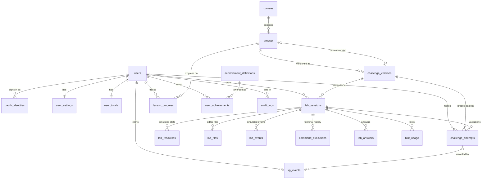

# Data model

- **Status:** Implemented (Part 05). Source of truth: [`apps/api/db/migrations`](../../apps/api/db/migrations); queries in [`apps/api/db/queries`](../../apps/api/db/queries), compiled by sqlc into `db/generated`.
- PostgreSQL 18. Time-ordered keys use `uuidv7()`; lab IDs use random `gen_random_uuid()` because they appear in URLs.

## Entity relationships

`outbox_events` has no foreign keys: it references aggregates by type and ID, and its rows are notifications, not state.

## Invariants enforced by the database

| Invariant | Mechanism |
| --- | --- |
| One user per provider identity; never matched by email | PK `(provider, provider_subject)`, `UNIQUE (user_id, provider)` |
| Handles unique regardless of case, including tombstoned users | Unique index on `lower(handle)` |
| Roles are only `learner` or `admin`; default `learner` | `CHECK`, default |
| Published challenge versions are immutable and never deleted | Trigger `challenge_versions_guard` |
| A lesson's current version is a published version of that lesson | Trigger `lessons_current_version_guard` |
| One active lab per user per lesson | Partial unique index `WHERE state = 'active'` |
| An idempotent request (reset, finish) acts once per user, operation and key | PK `(user_id, operation, key)` on `idempotency_records` |
| Generated names and resource versions are never reused in a lab | `lab_sessions.generator_counter` and `resource_revision` only increase (stored, not derived) |
| Active labs have no `ended_at`; ended labs do | `CHECK` |
| A command runs at most once per request ID | `UNIQUE (session_id, request_id)` |
| At most 10 answer submissions per goal | `CHECK (submission_no BETWEEN 1 AND 10)` |
| XP is awarded at most once per event key | `UNIQUE (user_id, event_key)` |
| The XP ledger and audit log are append-only | Triggers; erasure and retention must opt in with a session setting |
| Totals never go negative | `CHECK (total_xp >= 0)` |
| Curriculum survives user deletion; courses with lessons can't be deleted | `ON DELETE RESTRICT` from lessons and labs to curriculum |
| User deletion removes their labs, progress, XP and settings | `ON DELETE CASCADE` from user-owned tables |
| Simulated data stays bounded | Size `CHECK`s on resources (256 KiB), files (64 KiB), commands (16 KiB), outputs |

## Write paths

- **Lab mutations** go through `labs.Store.Mutate`: `SELECT … FOR UPDATE` on the session (with the owner in the `WHERE`), run the change, bump `version`, append a `lab.state_changed` outbox row, commit. Tested with 80 concurrent writers: no lost updates, no duplicate versions, full rollback on error.
- **Simulator state** (Part 09): inside `Mutate`, `labs.LoadState` rebuilds the cluster from `lab_resources` plus the session's clock, seed, generator position and resource revision; the pure simulator applies the change and reconciles; `persist` writes only changed and deleted rows, appends events stamped with the new version (keeping the newest 500), and saves the counters. Reads (`Snapshot`) use a read-only repeatable-read transaction so resources and version match.
- **Idempotent lab actions** store the response in `idempotency_records` in the same transaction; retries return it, a key reused for another lab is a `409`. Records are pruned after 7 days by the worker.
- **XP** goes through `gamification.GrantXP` inside the caller's transaction; a duplicate event key changes nothing.
- **Provisioning** (`users.Store.Provision`) creates the user, identity, settings and totals in one transaction and converges under concurrent first sign-ins.
- **Role changes** happen only through `api admin set-role`, with an audit entry in the same transaction.
- Transactions retry automatically on serialization failures and deadlocks (`database.WithTx`).
