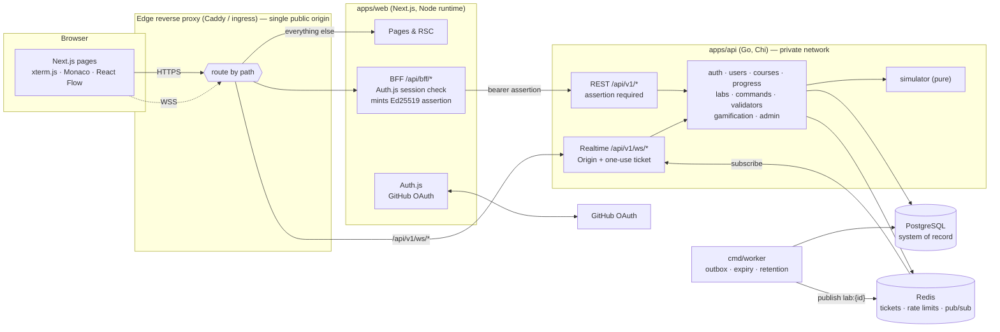
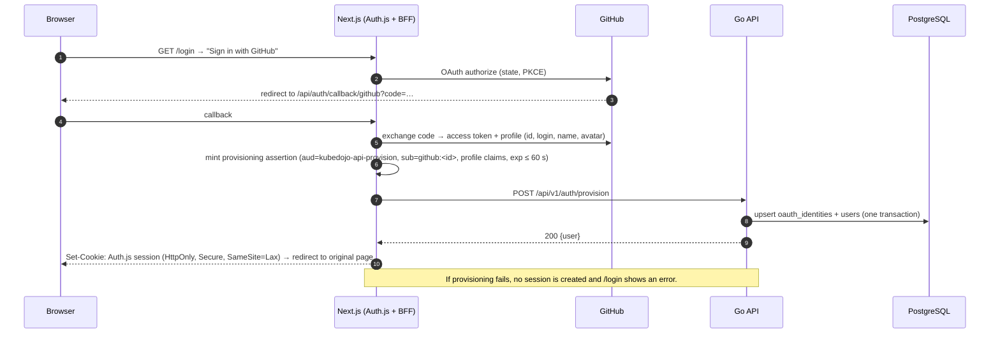
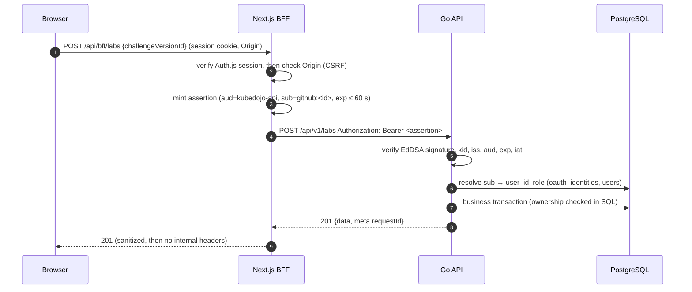
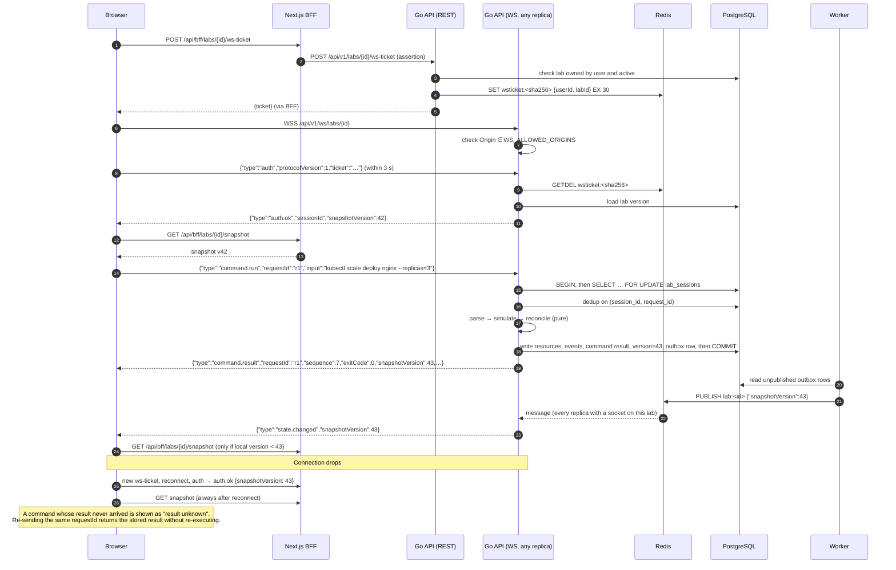
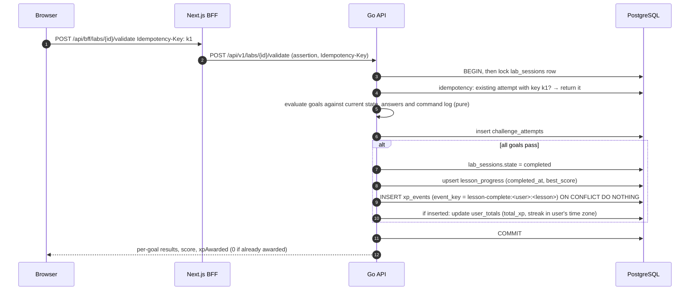
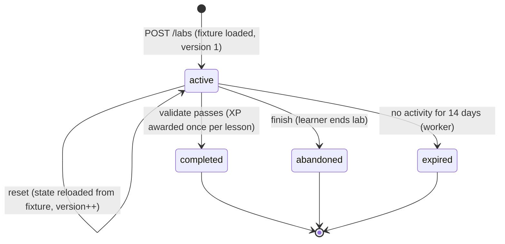

# Architecture overview

- **Status:** Accepted (Part 01)
- Decisions behind this design: [ADR index](../adr/README.md)

## 1. Components

| Component | Owns | Trusts |
| --- | --- | --- |
| Browser | Nothing authoritative; UI state only | Nothing |
| Edge proxy | TLS termination, routing | — |
| Next.js / BFF | Browser sessions (Auth.js cookie), the signing key for internal assertions | GitHub (OAuth), Go responses |
| Go API | All business rules and authorization | Assertions signed by a configured `kid`; its own database |
| Worker | Background jobs | Its own database |
| PostgreSQL | All durable state | — |
| Redis | Ephemeral coordination | — |

## 2. Request flows

### 2.1 Sign-in and provisioning

### 2.2 Authenticated REST call

### 2.3 Lab connection, command and reconnect

### 2.4 Grading and XP

Duplicate XP is impossible by construction: the XP event key is unique per user and lesson, the insert and the total update share a transaction, and retries with the same idempotency key return the stored attempt.

## 3. Lab session lifecycle

- **One active session per user per lesson** (partial unique index). `POST /labs` for a lesson with an active session returns that session (`200`, not `201`).
- **Completed, abandoned and expired sessions are read-only.** Starting the lesson again creates a new session; completing it again gives no XP.
- **Reset** never decreases `version`; clients treat it like any other state change.
- **Resource purge:** 30 days after a session leaves `active`, its resources, files, events and commands are deleted; the session row and attempt history remain for progress.
- **Simulator upgrades:** a session stores `simulator_version`. If the running API no longer supports it, the session is marked `expired` with reason `SIMULATOR_UPGRADED` and the learner is offered a fresh start; old state is never reinterpreted by a newer simulator.

## 4. Data ownership

| Data | Owner (writes) | Readers | Storage |
| --- | --- | --- | --- |
| Identity, roles | `auth`, `users` | all domains (via principal) | `users`, `oauth_identities` |
| Profile, settings | `users` | `progress`, `gamification` (leaderboard opt-in) | `users`, `user_settings` |
| Courses, lessons, challenge versions | `courses` (import), `admin` (publish) | `labs`, `validators`, `progress` | `courses`, `lessons`, `challenge_versions` |
| Lab sessions, resources, files, events, commands, answers | `labs` (via `simulator` + `commands`) | `validators`, `realtime` | `lab_*`, `command_executions` |
| Attempts, hints | `validators` | `progress`, `gamification` | `challenge_attempts`, `hint_usage` |
| Lesson progress | `progress` (only on verified completion or lesson open) | dashboard | `lesson_progress` |
| XP, streaks, achievements | `gamification` | dashboard, leaderboard, profile | `xp_events`, `user_totals`, `user_achievements` |
| Audit log | `admin`, `auth` | `admin` | `audit_logs` |
| Notifications | any writer, via outbox | `realtime` | `outbox_events` → Redis |

Rules:

- A domain writes only its own tables; other domains go through its Go interface.
- Every query on lab data includes `user_id` (directly or via a join to `lab_sessions`) so that ownership is enforced in SQL, not just in handlers. A lab that exists but belongs to someone else returns `404 NOT_FOUND`, not `403`, so lab IDs can't be probed.
- No domain trusts XP, scores, completion, role or user ID from a request body.

## 5. Questions a new developer should be able to answer

| Question | Answer |
| --- | --- |
| Where is truth stored? | PostgreSQL. Redis is disposable; the browser is a view. |
| Who authenticates each request? | Browser → Next.js: Auth.js session cookie. Next.js → Go: Ed25519 assertion (≤ 60 s). Browser → Go WebSocket: Origin check + one-use ticket issued through the BFF. |
| How does a lab reconnect? | New ticket → new socket → `auth.ok` with the current version → `GET /snapshot`. Commands are never replayed automatically; re-sending a `requestId` returns the stored result. |
| How is duplicate XP prevented? | Unique `xp_events.event_key` per user and lesson, inserted in the same transaction that updates totals; validation calls carry idempotency keys. |
